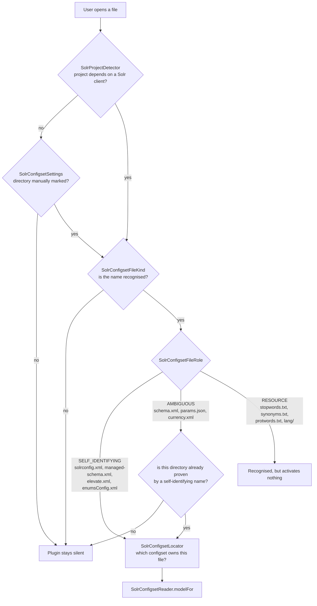
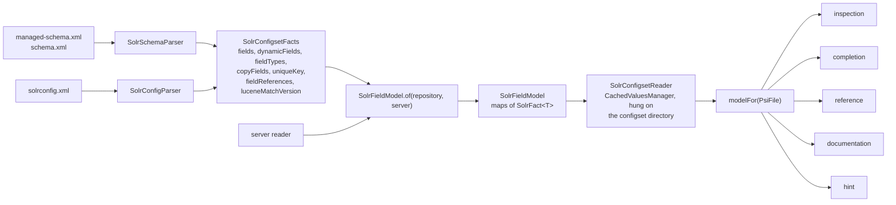
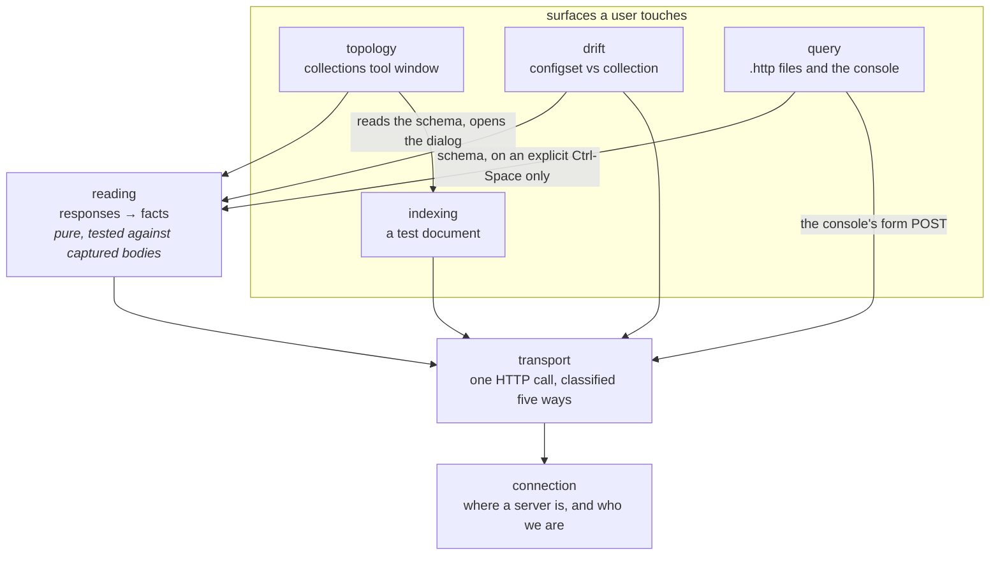

# Code organization

Where a change goes, and what the package you put it in will not let you do. What each package
contains is described once, in the per-package overview the API reference renders from
[`Module.md`](Module.md) — run `./gradlew dokkaGenerate` and open `build/dokka/html`.

## The organising principle

Packages are organised **by surface, then by subject, then by gesture** — and the third level
collapses wherever there is only one gesture.

The three surfaces — configuration files, a live server, and Java/Kotlin code — are the top level.
Inside a surface comes *which Solr thing this is about*: for [`configset`](glossary.md#configset)
that is the file, `schema` or `solrconfig`. Only then comes the IDE gesture —
[`inspection`](glossary.md#inspection), `completion`, [`reference`](glossary.md#reference),
`documentation` — each named for the [extension point](glossary.md#extension-point) it implements,
and each **one capability, not one layer**: there is no `service` package, no `util`, no `impl`.

**A capability falls under an aspect when the caret that triggers it is always in that aspect's
file.** Ask which file the user's cursor is in at the moment the capability fires, and that answer
is the package. A capability that traverses the configset has no single such file:
[Find Usages](glossary.md#find-usages) starts on a schema declaration and must reach
[`solrconfig.xml`](glossary.md#solrconfigxml), and [rename](glossary.md#rename-refactoring) must
update the `qf` line there too. Those live at the configset root, in `configset.navigation`, because
filing them under `schema` would make `configset.schema` import `configset.solrconfig`.

**The prohibition is one-directional.** Neither aspect may import the other. A package *above* the
aspects may import both, and two must: `configset.reading` names both parsers because choosing
between them by file kind is its job, and `configset.navigation` names both aspects' reference types
because a usage-type provider has to label a hit from either. The test is direction, not
co-occurrence: sideways between aspects is forbidden, downward from the shared layer into both is
the design.

`org.apache.solr.ide.model` is outside the surfaces. It is what both sources read — `SolrFact` holds
a repository value *and* a server value — and it is the only tree with no IntelliJ types in it, which
is what lets the correctness-critical code be tested as plain JUnit over a string. Inside it,
`model.schema` is what a field *is*, whichever source described it; `model.vocabulary` is what a
configuration file may legally contain. The test that separates them: **would the server reader need
this to interpret what it fetched?** Solr's schema API returns [`indexed`](glossary.md#indexed),
[`stored`](glossary.md#stored), [`omitNorms`](glossary.md#omitnorms) and
[analyzer chains](glossary.md#analyzer-chain), so all of `model.schema` applies to a
[collection](glossary.md#collection). It returns JSON and has no elements or attributes, so nothing
in `model.vocabulary` will ever have a server half.

**New packages are created when they have a file to hold, not in advance.** Do not scaffold a
`configset.solrconfig.hint` package because `configset.schema.hint` exists.

## The tree

```
org.apache.solr.ide
├── SolrBundle                    every user-visible string, in one place
├── SolrIcons                     the plugin's own icons, for plugin.xml to name
│
├── model                         what a configset MEANS — no IntelliJ types anywhere in here
│   ├── schema                      what a field IS: its type, what it can match, what it can do
│   ├── vocabulary                  what a FILE may legally contain: element names, class names
│   └── query                       a query string read for its field names and operators
│
├── configset                     the files in the repository — one of two sources of the model
│   ├── activation                  is this even a Solr project, and which configset owns this file
│   ├── reading                     the whole DIRECTORY → one model. Platform-aware, and caches
│   ├── editing                     guard rails both aspects' inspections and fixes share
│   ├── navigation                  the gestures that cross files: Find Usages, rename
│   │
│   ├── schema                      managed-schema.xml / schema.xml
│   │   ├── parsing                   one file's TEXT → facts. No IntelliJ types at all
│   │   ├── inspection                the underline, and Alt+Enter fixes on it
│   │   ├── intention                 Alt+Enter on a file that is already CORRECT
│   │   ├── completion                the popup on Ctrl+Space
│   │   ├── reference                 what makes a string Ctrl+Clickable
│   │   ├── documentation             the popup on F1 / hover
│   │   ├── hint                      grey text the IDE draws that is not in the file
│   │   ├── descriptor                teaching the platform's XML support this file's shape
│   │   └── annotator                 dimming code that is correct but says nothing extra
│   │
│   └── solrconfig                  solrconfig.xml — same gestures, fewer of them
│       ├── parsing
│       ├── inspection
│       ├── completion
│       ├── reference
│       ├── descriptor
│       └── documentation
│
├── code                          the project's own Java and Kotlin — which Solr it calls, for which fields
│   ├── solrj                       the first recognizer: SolrJ client and query calls, read through UAST
│   ├── inspection                  a field name in code that no configset declares
│   ├── completion                  field names where code is naming one
│   ├── navigation                  Ctrl+Click from a name in code to the schema
│   ├── highlighting                a query string, coloured by structure
│   └── run                         the gutter icon that runs a query string
│
└── server                        nothing on the editor path may import any of this
    ├── connection                  how to reach a running Solr, and remembering it
    ├── transport                   the HTTP call, the credential, and how an answer is classified
    ├── reading                     a Solr response turned into facts
    ├── topology                    the collections tool window
    ├── query                       queries in `.http` files, and what their answers say
    │   └── screen                  the query console: Solr Admin's form in a tab, run by the plugin
    ├── drift                       configset against collection, and the writes that close a gap
    └── indexing                    a test document written for one collection, and sent there
```

### If you have not written an IntelliJ plugin before

Every leaf under an aspect is named for a **platform extension point** — a slot the IDE calls into.
What each one *is* is best described by what the user sees:

| Package | What the user sees | You are changing it when |
|---|---|---|
| `inspection` | An **underline**, an entry in the Problems view, and often an Alt+Enter fix on it | Something in the file is *wrong* and the plugin should say so |
| [`intention`](glossary.md#intention) | An **Alt+Enter menu item on a file with nothing wrong with it** — no underline | You are offering an improvement or a generated edit, not reporting a defect |
| `completion` | The **popup on Ctrl+Space**, or as you type | You want to offer what may legally be written at the caret |
| `reference` | **Ctrl+Click navigates**, Find Usages finds, rename updates | A string in one file names something declared elsewhere |
| `documentation` | The **popup on F1**, or on hover | You want to explain the thing under the caret |
| `hint` | **Grey text the IDE draws inline** that is not in the file | You want to annotate code without changing it |
| [`annotator`](glossary.md#annotator) | **Dimmed text**, never in the Problems view | Something is correct but removable |
| `descriptor` | Nothing directly — it changes what *other* features know | The platform's own XML support needs to be told this file's vocabulary |
| `activation` | Whether the plugin does **anything at all** in this project | You are changing what counts as a Solr project or configset |
| `parsing` | Nothing directly — everything else reads its output | You are changing what the plugin understands from **one file's text** |
| `reading` | Nothing directly — it produces the model every feature reads | You are changing how the **whole directory** becomes one model, or how that is cached |

**`inspection` versus `intention`.** Both put items behind Alt+Enter. An inspection says *this is
wrong*, so it must not fire on a correct file. An intention says *here is something you might want*,
and firing on a correct file is the whole point. If your change would underline something, it is an
inspection; if it would not, it is an intention.

**`reference` is worth more than it looks.** Implementing it once gets Ctrl+Click, Find Usages *and*
rename, because the platform builds all three on the same abstraction.

**`parsing` versus `reading` is where the platform enters.** A parser turns *one file's text* into
facts and knows nothing else — no directory, no caching, no IntelliJ types — so its tests are plain
JUnit over a string. `reading` locates the configset's files, hands each to the right parser, merges
the results into one model, and caches it; it is full of `Project`, `VirtualFile` and `Service`. A
fact you can derive from a file's text belongs in `parsing`. The moment a change needs to know which
file it is looking at, or wants to remember an answer, it has crossed into `reading`.

## Where does my change go?

Two questions, in order: **which file is the caret in**, then **what is the gesture**.

| If you are changing… | schema files | `solrconfig.xml` |
|---|---|---|
| How **one file's text** becomes facts | `configset.schema.parsing` | `configset.solrconfig.parsing` |
| Something the editor reports as wrong | `configset.schema.inspection` | `configset.solrconfig.inspection` |
| What is offered at the caret | `configset.schema.completion` | `configset.solrconfig.completion` |
| Which strings become references | `configset.schema.reference` | `configset.solrconfig.reference` |
| What a hover explains | `configset.schema.documentation` | `configset.solrconfig.documentation` |
| Something shown inline without being asked | `configset.schema.hint` | — |
| Something offered on a file already correct | `configset.schema.intention` | — |
| Something dimmed as correct but removable | `configset.schema.annotator` | — |
| What the platform's XML support knows | `configset.schema.descriptor` | `configset.solrconfig.descriptor` |

And the parts that belong to no single file:

| If you are changing… | It goes in | Read first |
|---|---|---|
| What a configset *means* — fields, types, analyzer chains, what a field can match | `model.schema` | [Extend the field model](how-to/extend-the-field-model.md) |
| What a configuration file may legally contain | `model.vocabulary` | [Extend the field model](how-to/extend-the-field-model.md) |
| The grammar of a query parameter's value | `model.query` | [Extend the field model](how-to/extend-the-field-model.md) |
| How the **whole directory** becomes one model, and the cache in front of it | `configset.reading` | [From files to the model](#from-files-to-the-model) |
| Whether the plugin runs at all, or which configset owns a file | `configset.activation` | [The activation decision](#the-activation-decision) |
| Ctrl-click, Find Usages, rename | `configset.navigation` | [Add an editor feature](how-to/add-an-editor-feature.md) |
| Guard rails shared by both aspects' inspections and fixes | `configset.editing` | [Add an editor feature](how-to/add-an-editor-feature.md) |
| What the project's Java and Kotlin say about Solr | `code`, `code.solrj`, and the five surfaces beside it | [The code surface](#the-code-surface) |
| Anything that talks to a running Solr | `server.*` | [The server surface](#the-server-surface) |
| A user-visible string | `org.apache.solr.ide` (`SolrBundle`) | — |

If your change spans two of these, that is usually correct — an inspection reads the model and
reports through the platform, and both halves belong where they are.

**What is not correct is `configset.schema` importing `configset.solrconfig`, or the reverse.** They
share downward only, through `model`, `configset.reading`, `configset.editing` and
`configset.navigation`. A solrconfig inspection that needs to know whether a field is indexed reads
that from `model`, never from the schema aspect — which is what
`SolrNonIndexedRelevanceFieldInspection` does.

> **In Java terms.** The same discipline as a hexagonal-architecture port boundary between two
> adapters that must not know about each other. The compiler would allow the import;
> `SolrPackageBoundaryContractTest` walks the source tree and fails the build on any file in either
> aspect that names the other.

## Rules that hold across every package

**Nothing in `model` imports an IntelliJ type.** This is what makes the model testable without a
[fixture](glossary.md#fixture) — roughly a third of the suite is plain JUnit 4 because of it. The
plain tests would not notice a platform import, since the platform is on their classpath either way,
so `SolrPackageBoundaryContractTest` holds this for `model`, both `parsing` packages and the
`SolrXmlDocuments` they are built on.

> **In Java terms.** The same discipline as a domain layer that imports no Spring or JPA type —
> `SolrFieldModel` and friends stay plain data, the way a domain `Order` stays a POJO instead of an
> `@Entity`, and are testable with plain JUnit rather than `BasePlatformTestCase`.

**`configset.schema` and `configset.solrconfig` never import each other.** Held by
`SolrPackageBoundaryContractTest`; see [the organising principle](#the-organising-principle).

**Nothing on the editor path contacts a server.** Configset editing works with no connection
configured at all. `SolrServerBoundaryContractTest` fails the build on any package outside
`org.apache.solr.ide.server` that imports from it, except those it names in its allowlist.

**Detection runs on every file the user opens**, so its signals stay cheap, local, and cached. A new
detection signal that reads a file, resolves a dependency graph, or walks a directory tree is on the
wrong side of that line.

**Every contribution declares itself dumb-aware, and that is a promise about data sources.** The rule,
and the one contribution that must both decline and guard, are in
[platform mechanisms](platform-mechanisms.md#dumb-mode-and-dumbaware).

**Never build a cache in front of `SolrConfigsetReader.modelFor`.** See
[caching the field model](platform-mechanisms.md#caching-the-field-model).

**Inspections must not fire on a correct file.** Use `SolrInspections`, and write the clean fixtures
first. [The inspection catalog](inspection-catalog.md) records what each one stays silent about.

**The plugin edits configuration files directly and never refuses a write.** Solr's default configset
carries a banner saying the file is managed by the Schema API; the plugin edits it anyway, because it
is a source file in your repository. Code or docs asking whether a write is *allowed* should go.

## The activation decision

Two gates, in order, and silence is the designed outcome outside a Solr project.



`SolrProjectDetector` matches a Solr client **by artifact id, never by version** — `solr-solrj`, or a
wrapper that carries it such as Spring Data Solr, Camel, or the Quarkus extensions. That is a fact
about the dependency graph rather than an inference from a directory listing.

The role tiers exist because file names prove different amounts. `solrconfig.xml` carries Solr's own
vocabulary and stands alone. `schema.xml` is shared with far too many other things — an unrelated XSD
named `schema.xml` must stay untouched — so it counts only inside a directory a self-identifying name
has already proven. Resources such as `stopwords.txt` are too common to prove anything and never
activate anything, though they are recognised once inside a known configset.

`SolrConfigsetLocator` caches its answer, because this runs every time a file is opened.

A manually marked root in `SolrConfigsetSettings` bypasses the outer gate. A repository of bare
configsets has no build file, so no dependencies to detect, and the manual root is the only way it
activates at all. Those settings persist to the shared `solr.xml` rather than workspace-local
storage, because a marked root is a fact about the project rather than about one machine — so paths
are collapsed through `PathMacroManager` on write (`$PROJECT_DIR$/core/conf`) and expanded on read.
Treat `state.manualConfigsetRoots` as storage-form only; read `manualRoots` for usable absolute
paths. The user reaches it through *Mark Directory as Solr Configset Root* and
**Settings → Languages & Frameworks → Solr Configsets**; see
[why nothing is happening](installing.md#why-nothing-is-happening).

## From files to the model

Every editor feature asks the same question, and none of them answers it for itself.



`SolrConfigsetReader.modelFor(PsiFile)` lives in `configset.reading` rather than beside any one
feature, because otherwise four features would import the fifth.

The parsers are **pure functions from text to facts**, using the JDK's DOM rather than IntelliJ's XML
[PSI](glossary.md#psi), which is what lets them be tested without an IDE. External entities and
doctypes are refused: a cloned repository is not trusted input, and entity resolution would run
while the user is merely opening a file.

How the model is cached, and what invalidates it, is owned by
[caching the field model](platform-mechanisms.md#caching-the-field-model). For what one caret does
with it — the order the platform calls a feature in, and where a null model turns into silence — see
the sequences in [the editor-feature guide](how-to/add-an-editor-feature.md).

`SolrConfigsetScanner` answers the question the per-file locator cannot: which configsets does this
*project* contain. It walks content roots and prunes build output and dependency trees, so it is not
an editor-path operation.

## Tracing one gesture, end to end

This follows a single thing a user sees — `q.addFilterQuery("categry:books")` underlined at
`categry` — from the registration down to the model and back. Every other feature is the same shape
with different names in it.

```mermaid
sequenceDiagram
    participant P as Platform
    participant I as code.inspection<br/>SolrUnknownCodeFieldInspection
    participant R as code<br/>SolrRecognizers
    participant D as configset.activation<br/>SolrProjectDetector
    participant J as code.solrj<br/>SolrJRecognizer
    participant C as configset.reading<br/>SolrConfigsetReader
    participant M as model<br/>SolrFieldModel

    P->>I: checkFile(ProductSearch.java)
    I->>I: no UAST plugin for this language? stop
    I->>R: fieldUsagesIn(file)
    R->>D: moduleDependsOn(module, SolrJ coordinates)
    Note over D: library names off the project model — no index read
    R->>J: readFieldUsages(file)
    Note over J: one UAST walk; a call counts only if its method names fields<br/>AND its receiver resolves to SolrQuery (fieldNamingMethod)
    J-->>I: SolrFieldUsage("categry", element, range inside the literal)
    I->>C: modelFor(each configset)
    Note over C: cached by the platform, invalidated by the files it read
    C-->>I: SolrFieldModel
    I->>M: resolve("categry") — declared field or dynamic pattern?
    M-->>I: null in every configset
    I-->>P: problem on the range, with closest-spelling fixes
```

**What each step is there to protect:**

1. **The registration decides who is asked, not the class.** `plugin.xml` registers the inspection
   *without a language*, so every file the IDE inspects reaches `checkFile`. Turning away a file no
   JVM language reads is the first line, because everything after it costs something.
2. **The module gate runs before any reading.** A module without SolrJ is never read at all, and the
   gate reads library names from the project model, never the index, so it is cheap enough for every
   file the user opens. Indexing is a different matter: this inspection is not dumb-aware and waits
   for indexing to finish, because finding the configsets in step 4 needs the filename index.
3. **The recognizer is the only thing that knows SolrJ.** It returns plain facts — a name, the
   element it sits in, and the range of the name inside that element — and the inspection never
   looks at a `UCallExpression` itself. That is what lets navigation, completion and colour read the
   same facts and agree.
4. **The model is asked once per file, not once per finding.** Finding the configsets goes through
   the filename index, and a file with ten typos must not pay for ten index queries.
5. **No configsets means no answer, not "every name is wrong".** `configsetModelsIn` returns null
   rather than an empty list, because an empty list would condemn every name in the project.
6. **The warning covers the name, not the string.** `rangeInElement` is why `categry` is underlined
   and the quotes, the colon and `books` are not.

To follow another feature, find its line in `plugin.xml`, open the class it names, and read
downwards the same way: the guard that turns most callers away, the call into a shared reader, the
model lookup, and what comes back.

## The code surface

`code` holds the contract every recognizer implements; `code.solrj` is the first implementation, and
each further library recognized gets a sibling package. The five packages beside `code.solrj` are the
surfaces, one each, and **every one of them reads the recognizer rather than the file**:

| Package | Puts on screen | Registered as |
|---|---|---|
| `code.inspection` | A field name no configset declares, underlined at the name | `localInspection` |
| `code.completion` | Field names where code is naming one, opening by itself as one is typed | `completion.contributor`, `completion.confidence`, `typedHandler` |
| `code.navigation` | <kbd>Ctrl-click</kbd> from a name in code to the schema's `<field>` | `psi.referenceContributor` |
| `code.highlighting` | Fields and operators inside a query string, coloured, and the page that tunes the colours | `annotator`, `colorSettingsPage` |
| `code.run` | A gutter icon that runs the query against a chosen collection | `codeInsight.lineMarkerProvider` |

**Two surfaces answering the same question must not answer it twice.** The check and the navigation
are silent in exactly the same places because both call `SolrRecognizers.fieldUsagesIn`, and
completion offers names in exactly the positions the check examines because both call
`SolrJFieldPositions.fieldNamingMethod`. A surface that re-derived either would be a second rule able
to drift from the first. `code.run` is the one package here that reaches a server, and
`SolrServerBoundaryContractTest` names it in its allowlist for that reason.

**A recognizer never asks whether its library is present.** It declares the coordinates it needs and
`SolrRecognizers` answers, once, for all of them — against the *module*, so a repository where one
module talks to Solr does not have the others warned about their field names.

**Everything here reads through UAST rather than Java PSI**, so one implementation serves both JVM
languages. That is a claim the mirrored Java and Kotlin test suites keep honest rather than the
compiler — `Module.md`'s note on `code.solrj` explains why a Kotlin string is not a literal.

## The server surface

**Nothing on the editor path may import any `server` package.** `SolrServerBoundaryContractTest`
walks the source tree and fails on any package outside `org.apache.solr.ide.server` that names one,
which is why the rule is an allowlist of server consumers rather than a list of editor packages to
forbid — a list of what to forbid is wrong the day someone adds a package.

The packages are layered, and the layering is what keeps each one testable:



Each surface keeps its decisions in pure code and its Swing thin, so what a view *says* can be read
in a test. What each package holds is in [`Module.md`](Module.md).

**Every write names its target before it happens.** Upload and reload, an additive Schema API change
and indexing a test document each confirm first, naming the collection **and the server** — so a
dialog appearing means something is about to change, and says where. The server integration
specification owns this as its confirmation requirement for writes; it is repeated here because it
is the rule a new write path is most likely to skip.

**A write is never reported from its own answer.** The view re-reads, because an accepted request is
not proof the server agrees; see
[platform mechanisms](platform-mechanisms.md#every-read-is-on-request-and-every-write-re-reads).

Two rules in `drift` are worth knowing before changing it:

- **Spellings are resolved before comparing, never compared as written.** One analyzer factory is
  nameable three ways, and the two sources routinely disagree about which to use — and about case:
  Solr's `_default` configset writes `CJKWidth` where a server reads the same schema back as
  `cjkWidth`. `SolrClassCatalog.canonicalClassFor` resolves any spelling to the class it means. A
  factory the catalog does not know is compared as written, because inventing a resolution is how
  two different things become one.
- **The comparison takes two halves as separate arguments, never a model.** A model built with no
  server half reports every fact as repository-only, which is indistinguishable from a server that
  genuinely has none of them.
