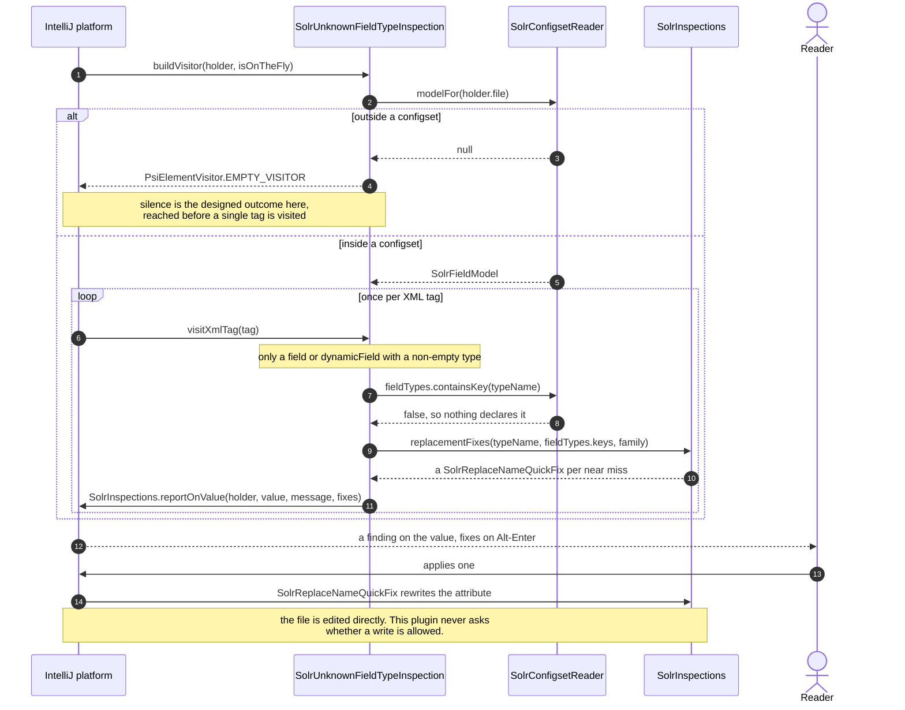

# Add an editor feature

The files to touch, in order, to land a new inspection, completion, reference, documentation or
inlay hint in this repository, and what will reject the change. It assumes you know what a
`LocalInspectionTool` or a `CompletionContributor` is;
[the plugin development tutorial](../modern-intellij-plugin-development.md) teaches the platform
from scratch.

The first half traces one inspection end to end. The second half gives the deltas for each other
capability.

---

## The walkthrough: an inspection

We follow `SolrUnknownFieldTypeInspection`, which reports a `field` whose `type` names a
[field type](../glossary.md#field-type) the [configset](../glossary.md#configset) does not declare.
The Kotlin is short; what matters is the seven other places it reaches into.

The round trip:



A null model means return something inert, checked once in `buildVisitor` rather than per tag.
Every feature below repeats that shape.

### 1. The inspection class

`src/main/kotlin/org/apache/solr/ide/configset/schema/inspection/SolrUnknownFieldTypeInspection.kt`

```kotlin
class SolrUnknownFieldTypeInspection : LocalInspectionTool() {

    override fun isDumbAware(): Boolean = true

    override fun buildVisitor(holder: ProblemsHolder, isOnTheFly: Boolean): PsiElementVisitor {
        val model = SolrConfigsetReader.getInstance(holder.project).modelFor(holder.file)
            ?: return PsiElementVisitor.EMPTY_VISITOR
        return object : XmlElementVisitor() {
            override fun visitXmlTag(tag: XmlTag) { /* ... */ }
        }
    }
}
```

Give the class [KDoc](../glossary.md#kdoc) saying *why the defect matters* — here, that Solr
refuses to load a core with an unknown field type. The build fails without it; see
[the documentation gate](testing-and-the-build-gates.md#documentation-dokka).

### 2. Declare dumb-awareness

```kotlin
override fun isDumbAware(): Boolean = true
```

The model is parsed from the configset's own text, so the feature works while the project indexes.
The mechanism depends on the [extension point](../glossary.md#extension-point):

| Extension point | How it declares |
|---|---|
| `LocalInspectionTool`, `CompletionContributor` | `override fun isDumbAware(): Boolean = true` |
| [Documentation provider](../glossary.md#documentation-provider), [inlay hint](../glossary.md#inlay-hint) provider | implement the `DumbAware` marker interface |

A feature that reads an index must both decline the declaration and guard with `DumbService`.
[Platform mechanisms](../platform-mechanisms.md#dumb-mode-and-dumbaware) has the reasoning;
`SolrDumbModeContractTest` holds the rule.

### 3. Reach the model, and let it gate you

```kotlin
val model = SolrConfigsetReader.getInstance(holder.project).modelFor(holder.file)
    ?: return PsiElementVisitor.EMPTY_VISITOR
```

`modelFor(PsiFile)` returns null when the file is not part of a configset the plugin recognises.
That null **is** the activation check; do not write your own. Do not put a cache in front of it
either — the reader already caches through `CachedValuesManager`.

### 4. Use the shared inspection helpers

`SolrInspections`, in `configset.editing`, holds three helpers you almost certainly want:

```kotlin
SolrInspections.reportOnValue(holder, value, message, fixes)
```

Reports on the text *inside* the attribute's quotes, so the underline covers `manufacturer` rather
than `"manufacturer"`.

```kotlin
SolrInspections.replacementFixes(wrong, candidates, familyText)
```

[Quick-fixes](../glossary.md#quick-fix) offering each valid candidate, closest spelling first and
capped at a handful. The inspection already computed the valid set to decide; offer it.

```kotlin
SolrInspections.isCheckableFieldName(name)
```

Excludes the names Solr answers for itself — `score`, `_version_`, `_root_` — and anything with a
wildcard or a leading `[`. Call it before flagging any field name.

**This is where reviews get stuck.** Solr configuration is full of syntax that looks like a field
name: `fl` legitimately holds `score`, `*`, `[docid]`, `max(price,0)` and `alias:name`. Write the
clean fixtures before the flagged one.

### 5. Bundle keys

`src/main/resources/messages/SolrBundle.properties` holds every user-visible string. The inspection
needs four:

```properties
inspection.group=Solr
inspection.fieldType.displayName=Unknown field type
inspection.fieldType.unknown=Solr: no field type named ''{0}'' is declared in this configset
quickfix.fieldType.family=Use a declared field type
```

Double the single quotes in a message with a placeholder. That is `MessageFormat`: a single `'`
swallows the placeholder and prints `{0}` literally.

Read them with `SolrBundle.message("inspection.fieldType.unknown", typeName)`.

### 6. The description HTML

`src/main/resources/inspectionDescriptions/SolrUnknownFieldType.html`

The filename must equal the `shortName` you register in `plugin.xml`; `SolrPluginDescriptorTest`
fails the build when no file matches.

Explain the consequence and give an example — this is what a user reads when deciding whether to
keep the inspection on:

```html
<html>
<body>
Reports a <code>field</code> or <code>dynamicField</code> whose <code>type</code> names a field type
the configset does not declare.
<p>
  Solr refuses to load a core with an unknown field type. The mistake is easy to make while editing,
  because generic word completion will happily offer any word already present in the file — including
  attribute names such as <code>stored</code>.
</p>
</body>
</html>
```

### 7. Register it in `plugin.xml`

[`src/main/resources/META-INF/plugin.xml`](../glossary.md#pluginxml)

```xml
<localInspection
    language="XML"
    shortName="SolrUnknownFieldType"
    bundle="messages.SolrBundle"
    key="inspection.fieldType.displayName"
    groupBundle="messages.SolrBundle"
    groupKey="inspection.group"
    enabledByDefault="true"
    level="ERROR"
    implementationClass="org.apache.solr.ide.configset.schema.inspection.SolrUnknownFieldTypeInspection"/>
```

`shortName` couples to the HTML file in step 6; `key` and `groupKey` resolve against the bundle in
step 5.

**`level="WARNING"` by default; `ERROR` only for a name that resolves to nothing.** The plugin's
model of a half-typed file is not authoritative enough for a hard error. The exceptions — a
copyField end, a field's type, an attribute name or a handler parameter's field that names nothing
the configset declares — are `ERROR` because the editor presents an unresolved name as one, and
because the light colour schemes draw a warning as a pale background with no underline. Argue any
other `ERROR` in the PR, and assert how it is drawn in `SolrFindingPresentationTest`.
[The inspection catalog](../inspection-catalog.md) lists each registered severity.

Add a comment above the registration when the entry is not self-explanatory, as the existing blocks
do.

### 8. The test

`src/test/kotlin/org/apache/solr/ide/configset/schema/inspection/SolrUnknownFieldTypeInspectionTest.kt`

```kotlin
class SolrUnknownFieldTypeInspectionTest : SolrConfigsetTestCase() {

    private fun check(body: String) {
        myFixture.enableInspections(SolrUnknownFieldTypeInspection())
        myFixture.configureByText("managed-schema.xml", schema.replace("BODY", body))
        myFixture.checkHighlighting(true, false, false)
    }

    fun testAFieldNamingAnUndeclaredTypeIsFlagged() {
        check("""<field name="sku" type="<error descr="Solr: no field type named 'stored' is declared in this configset">stored</error>"/>""")
    }

    fun testFieldsNamingDeclaredTypesAreClean() {
        check("""<field name="sku" type="string"/><field name="body" type="text_general"/>""")
    }
}
```

- Extend **`SolrConfigsetTestCase`**, not `BasePlatformTestCase`, so the fixture has a Solr client
  on its classpath and the test cannot pass because the plugin ignored the project.
- Name methods `testSomething()`.
- Add a `testNothingIsReportedOutsideASolrProject` case using `givenNoSolrOnTheClasspath()`.

[Testing and the build gates](testing-and-the-build-gates.md) has the conventions behind each.

---

## The deltas

Same spine every time: reach the model through `modelFor`, return something inert when it is null,
declare dumb-awareness, register in `plugin.xml`, put strings in `SolrBundle`, test with a fixture.
Here is what differs.

### Completion

`configset/schema/completion/SolrSchemaCompletionContributor.kt` — extends `CompletionContributor`,
registered as `<completion.contributor language="XML">`, overrides `isDumbAware()`.

The contributor registers *providers* against PSI patterns in its `init` block; each extends
`CompletionProvider<CompletionParameters>` and implements `addCompletions`. The schema contributor
has two: one for attribute values, one for the schema's element and attribute vocabulary.

**Only complete closed sets.** Where any value is legal, contribute nothing: a completion list
implies the values not on it are wrong. Where you offer `true`/`false`, mark the value Solr uses
when the attribute is absent — unless that default depends on the field type, in which case mark
neither.

**Take the prefix from the token, not from the platform.** On the `solrconfig.xml` side,
`SolrParameterFieldCompletionProvider` asks `SolrConfigParser.fieldTokenAt` for the token being
typed and passes it to `result.withPrefixMatcher(prefix)`. The platform's default matcher reads an
identifier back from the caret and does not know Solr's separators, so in `sort=id asc,` it filters
a correct list down to nothing. Offer only names that can serve the parameter — filter with
`model.mayServe`, do not annotate.

No description HTML, no `shortName`.

### References and navigation

`configset/schema/reference/SolrSchemaReferenceContributor.kt` — extends `PsiReferenceContributor`,
registered as `<psi.referenceContributor language="XML">`, implements `registerReferenceProviders`.

You write three things: a `PsiReferenceProvider` returning references for a matched element, a
`PsiReference` that knows how to `resolve()`, and a PSI pattern binding them. `SolrCopyFieldReference`
and `SolrFieldTypeReference`, both extending `SolrDeclarationReference`, are the worked examples.

- **References are soft.** An unresolved hard reference draws a platform warning that duplicates
  what the inspections already report, in the platform's vocabulary rather than Solr's.
- **`getVariants()` returns empty.** Completion is the completion package's job.
- **Follow a glob only as far as it is written.** `copyField dest="*_t"` resolves to the
  `dynamicField` that spells the same pattern, never to a concrete field it might match.

`SolrSchemaPsi` gets you from a model answer back to PSI: the model can say a field type exists, but
not where it was written. Find Usages and rename traverse the whole configset, so they live in
`configset.navigation`.

### Quick documentation

`configset/schema/documentation/SolrSchemaDocumentationProvider.kt` — extends
`AbstractDocumentationProvider` and implements `DumbAware`, registered as
`<lang.documentationProvider language="XML">`.

Three methods matter. `getCustomDocumentationElement` decides *what* the caret is on; return null to
let the caret fall through to whatever else would answer. `generateDoc` builds the HTML. `getUrlFor`
supplies the external link.

**One hover runs two halves**: the documentation, and the presentation that needs the target's name
for the popup header. A test calling `generateDoc` exercises only the first. If
`getCustomDocumentationElement` returns something synthetic — a `FakePsiElement` standing for a
range inside a text node — it must supply a name, or the popup fails with correct HTML already
built. Test through `IdeDocumentationTargetProvider` so both halves run.

**Link to the Reference Guide, never copy it**, at the version the configset declares, and at page
level because anchors drift between releases. **Nothing on the editor path fetches a URL** — you
supply a link, you do not follow it.

`SolrSchemaElements` holds what each schema element is; add to it rather than embedding prose in
the provider.

### Inlay hints

`configset/schema/hint/SolrMatchInlayHintsProvider.kt` — implements `InlayHintsProvider` and
`DumbAware`, with a collector implementing `collectFromElement`.

Its registration carries a user-facing toggle:

```xml
<codeInsight.declarativeInlayProvider
    language="XML"
    providerId="solr.match.capability"
    bundle="messages.SolrBundle"
    nameKey="inlay.matchCapability.name"
    group="OTHER_GROUP"
    isEnabledByDefault="true"
    implementationClass="org.apache.solr.ide.configset.schema.hint.SolrMatchInlayHintsProvider"/>
```

`providerId` identifies it in settings; `nameKey` is what the user sees in the inlay-hints settings
tree.

**Say nothing when unsure.** An inlay appears without the user asking, so a wrong claim is worse
than a missing one. The existing provider stays silent on a field whose type the configset does not
declare, and where the analysis is not confident it drops the match half and shows only the storage
shape.
