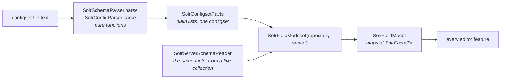

# Extend the field model

How to add a new fact — a field, an attribute, a relationship — to `org.apache.solr.ide.model`, the
plain data model every editor feature reads. [Add an editor feature](add-an-editor-feature.md)
covers the consuming side.

## Two rules

- **No IntelliJ types in `model`.** That is what keeps its tests plain JUnit 4 with no fixture;
  `SolrPackageBoundaryContractTest` fails the build otherwise.
  [Code organization](../code-organization.md#rules-that-hold-across-every-package) has the
  package rules.
- **A fact holds both halves.** `SolrFact<T>` carries `repository: T?` and `server: T?`, reports how
  they relate through `SolrAgreement`, and `effective` prefers the repository. Write new facts as
  `SolrFact<T>` even where only the repository half is filled: the editor path never fills the
  server half, but the drift view does, and a value that has already resolved the disagreement away
  has to be unpicked when a server surface needs it.

## The pipeline



Adding a fact means touching each stage in order. Skipping one is the usual bug: a parser that reads
something no `SolrConfigsetFacts` field carries throws the value away silently.

### 1. The type

`model/schema/SolrSchemaTypes.kt` holds the vocabulary — `SolrField`, `SolrFieldType`,
`SolrDynamicField`, `SolrCopyField`, `SolrAnalyzerChain`, `SolrAnalyzerComponent`,
`SolrFieldReference`. Add a `data class` here, or a property to an existing one.

Every public property needs [KDoc](../glossary.md#kdoc). Say what the value means in Solr's terms,
not what the type is.

### 2. The parser

`configset/schema/parsing/SolrSchemaParser` and `configset/solrconfig/parsing/SolrConfigParser` are
`object`s with a single entry point:

```kotlin
fun parse(xml: CharSequence): SolrConfigsetFacts
```

They are pure functions from text to facts, using the JDK's DOM rather than IntelliJ's XML
[PSI](../glossary.md#psi). Keep the `CharSequence` signature: a parser that needs a `PsiFile` has
moved into the platform and can no longer be tested without an IDE.

External entities and doctypes are refused, because a cloned repository is not trusted input and
entity resolution would run while the user is merely opening a file. Anything you add that resolves
an external resource needs the same treatment.

### 3. `SolrConfigsetFacts`

```kotlin
data class SolrConfigsetFacts(
    val fields: List<SolrField> = emptyList(),
    val dynamicFields: List<SolrDynamicField> = emptyList(),
    val fieldTypes: List<SolrFieldType> = emptyList(),
    val copyFields: List<SolrCopyField> = emptyList(),
    val uniqueKey: String? = null,
    val fieldReferences: List<SolrFieldReference> = emptyList(),
    val luceneMatchVersion: String? = null,
    val schemaVersion: String? = null,
)
```

One [configset](../glossary.md#configset)'s raw parse output, as plain lists. Give every new
property a default, so a parser that does not produce it still compiles.

### 4. `SolrFieldModel`

`SolrFieldModel.of(repository, server)` merges the two halves: lists become maps keyed by name, and
values become `SolrFact<T>`. Add your fact to the constructor and to `of`.

Derived queries live here too — `typeOf`, `resolve`, `copyFieldsFrom`. If your fact needs
interpreting rather than just carrying, put the interpretation here or in its own model file, not in
the feature that first needed it; otherwise the second feature to need it will import the first.

### 5. The cache dependency

`SolrConfigsetReader` caches one model per configset through the platform's `CachedValuesManager`,
hung on the configset directory:

```kotlin
CachedValuesManager.getCachedValue(directory) {
    // ...
    CachedValueProvider.Result.create(
        model,
        sources.map { it.file } + VirtualFileManager.VFS_STRUCTURE_MODIFICATIONS,
    )
}
```

The source files rebuild the model when the configset changes; the VFS structure count notices a
`solrconfig.xml` that appears later, which no file dependency can.

**If your fact comes from a file the reader does not already read, add that file to `sourcesOf`.**
Otherwise the model is right on first read and stale after the first edit. Do not reach for
`PsiModificationTracker.MODIFICATION_COUNT` instead;
[platform mechanisms](../platform-mechanisms.md) explains why.

## Testing it

Test the parser against text and the model against constructed facts, separately, as plain JUnit 4
tests. [Testing and the build gates](testing-and-the-build-gates.md) has the conventions.

## What does not go here

- **Anything needing a `Project`, a `PsiFile`, or a `VirtualFile`.** That is `configset.reading`,
  or the aspect's own `parsing` package.
- **Anything reading a Solr server.** That is `server`, and it is unreachable from the editor path.
- **Presentation.** How a fact is worded for a user belongs in the feature that shows it —
  `SolrFieldPresentation` and `SolrSchemaElements` are in `configset.schema.documentation` for that
  reason.
