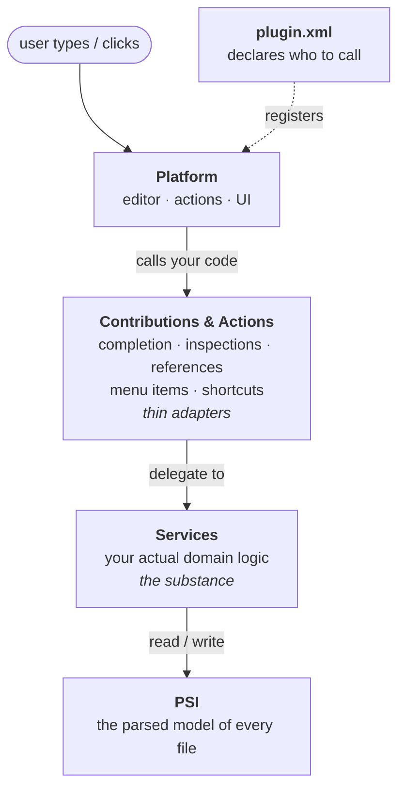
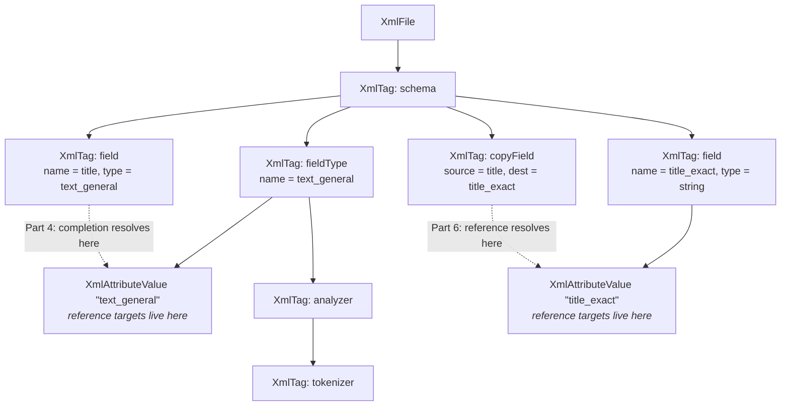

# Your First IntelliJ Plugin, the Modern Way

### A hands-on introduction for Java and Kotlin engineers

This tutorial builds a small standalone plugin, in a `dev.example.solrconfig` package, that adds
code completion, an [inspection](glossary.md#inspection) with a [quick-fix](glossary.md#quick-fix),
and Ctrl-click navigation with [rename refactoring](glossary.md#rename-refactoring) to a file format
the IDE has never heard of. It assumes no platform knowledge. It does not describe this repository's
own code; [the last section](#this-repository-as-the-worked-example) points there.

---

## What we're building

Our subject is an Apache Solr **[configset](glossary.md#configset)** — specifically
[`managed-schema`](glossary.md#managed-schema), an XML file that defines the fields of a search
index. You need no Solr knowledge. Here's the entire format we care about:

```xml
<schema name="example" version="1.6">
    <fieldType name="string"       class="solr.StrField"/>
    <fieldType name="text_general" class="solr.TextField">
        <analyzer>
            <tokenizer class="solr.StandardTokenizerFactory"/>
            <filter class="solr.LowerCaseFilterFactory"/>
        </analyzer>
    </fieldType>

    <field name="id"          type="string"       indexed="true" stored="true"/>
    <field name="title"       type="text_general" indexed="true" stored="true"/>
    <field name="title_exact" type="string"       indexed="true" stored="false"/>

    <copyField source="title" dest="title_exact"/>
</schema>
```

`title` is tokenized, so a search for one word hits it; `title_exact` is an untokenized `string`,
for exact matching, sorting and faceting. [`copyField`](glossary.md#copyfield) duplicates the value
into the second field at index time.

`<field type="...">` points at a `<fieldType name="...">`, and `<copyField source/dest>` points at a
`<field name="...">`. Those cross-references are strings, so a typo produces no error anywhere — the
file opens fine and the failure surfaces at runtime. That's the bug class IDE tooling exists to kill.

We'll ship three features:

1. **Completion** — typing inside `type="…"` suggests the [field types](glossary.md#field-type) defined in the file.
2. **An inspection with a quick-fix** — `copyField` pointing at a nonexistent field gets a warning, and Alt+Enter offers to create it.
3. **[References](glossary.md#reference)** — Ctrl-click on `dest="title_exact"` jumps to the field, and [Find Usages](glossary.md#find-usages) and rename work from there.

---

## Prerequisites

- IntelliJ IDEA 2026.1 or newer. Since 2025.3 there is a single unified distribution; the free tier is all you need.
- **JDK 21.** A plugin runs inside the IDE process, on the JetBrains Runtime the IDE ships with — currently a JBR 21 build — so bytecode for a newer release won't load. The SDK documents the required Java version per platform version; check it when you bump your target. This is independent of the Java your *projects* use.
- Familiarity with Gradle Kotlin DSL.

The Gradle plugin fetches the platform artifacts for you; there is no SDK to download.

**Versions this tutorial targets**

| Component | Version |
|---|---|
| IntelliJ Platform (compile/test target) | 2026.2 |
| IntelliJ Platform Gradle Plugin | 2.19.0 |
| Kotlin | 2.4.21 |
| JDK / bytecode target | 21 |
| Minimum supported IDE (`sinceBuild`) | 261 (2026.1) |

When something below doesn't match what you see, the [SDK docs](https://plugins.jetbrains.com/docs/intellij/) are the source of truth.

---

## Part 1 — Scaffold and run

Start from the **IntelliJ Platform Plugin Generator**: <https://plugins.jetbrains.com/generator>.
As of IntelliJ IDEA 2026.1 it replaces both the old in-IDE wizard and the
`intellij-platform-plugin-template` repository, so older instructions to clone that template are
out of date. It works like [start.spring.io](https://start.spring.io/):

- **In the browser** — choose *Plugin* (not *Theme*), tick the features you want, and **Download**. The *Preview* pane shows what each feature adds.
- **In the IDE** — *File | New | Project…*, then **IDE Plugin** under *Generators*. Requires IntelliJ IDEA 2026.1+ with the [Plugin DevKit](https://plugins.jetbrains.com/plugin/22851-plugin-devkit) plugin.

The defaults are fine for this tutorial. Tick **GitHub** (under *Version Control*) if you plan to
publish: it adds CI workflows, issue templates and Dependabot config.

You end up with a Gradle project whose build file looks roughly like this:

```kotlin
// build.gradle.kts
import org.jetbrains.intellij.platform.gradle.TestFrameworkType

plugins {
    kotlin("jvm") version "2.4.21"
    id("org.jetbrains.intellij.platform") version "2.19.0"
}

group = "dev.example"
version = "0.1.0"

kotlin { jvmToolchain(21) }

repositories {
    mavenCentral()
    intellijPlatform { defaultRepositories() }
}

dependencies {
    intellijPlatform {
        intellijIdea("2026.2")   // the IDE you compile and test against
        testFramework(TestFrameworkType.Platform)
    }
    testImplementation("junit:junit:4.13.2")
}

intellijPlatform {
    pluginConfiguration {
        id = "dev.example.solrconfig"
        name = "Solr Configset Support"
        ideaVersion {
            sinceBuild = "261"
            // untilBuild intentionally unset — forward compatible by default
        }
    }
    pluginVerification { ides { recommended() } }
}
```

- `intellijIdea("2026.2")` is a *compile and test* target, not a minimum; `sinceBuild` governs who can install. Older tutorials use `intellijIdeaCommunity(...)`, which predates the unified distribution.
- `testFramework(TestFrameworkType.Platform)` is easy to forget and produces baffling test-compilation errors when missing. It also needs the `import` at the top.
- `id` is permanent. Once published, changing it means publishing a different plugin.
- **JUnit 4** is what the platform's test framework pairs with `TestFrameworkType.Platform`: [`BasePlatformTestCase`](glossary.md#baseplatformtestcase), used in Part 7, descends from JUnit 3's `TestCase`.

Now run it:

```bash
./gradlew runIde
```

A second IntelliJ launches with its own settings directory and your plugin installed. This is your
dev loop. Use `./gradlew runIde --debug-jvm` and attach a remote debugger for breakpoints.

> **Checkpoint.** Open *Settings → Plugins → Installed* in the [sandbox](glossary.md#sandbox) and find your plugin by name.

---

## Part 2 — The mental model

### The IDE calls you

In a Spring controller you write one method and the framework calls it when a request arrives.
Plugin development is the same deal, with the IDE in Tomcat's role: it owns the loop — keystrokes,
file analysis, Ctrl+Space — and calls the small pieces of behavior you register.

An **[extension point](glossary.md#extension-point) is an interface plus a list of everybody who
implemented it.** `CompletionContributor` is an interface; when the user hits Ctrl+Space, the
platform walks every registered implementation and asks each one for suggestions. Each feature is
two steps: implement the right interface, and get on the right list.

### There is no component scanning

There is no annotation that registers an extension. Your class gets on the list because you wrote
it into [`src/main/resources/META-INF/plugin.xml`](glossary.md#pluginxml):

```xml
<extensions defaultExtensionNs="com.intellij">
    <completion.contributor
        language="XML"
        implementationClass="dev.example.solrconfig.completion.FieldTypeCompletionContributor"/>
</extensions>
```

The IDE reads each plugin's descriptor at startup and instantiates a class only when it is first
needed, which keeps startup fast with dozens of plugins installed. The consequence: **if your class
isn't in `plugin.xml`, it does not exist**, and nothing tells you. When a feature doesn't fire,
check `plugin.xml` first.

### The vocabulary

Most extensions fire on their own while the user works. **Actions** are different: they do nothing
until the user triggers them.

| Term | What the user sees | Built in |
|---|---|---|
| Completion | Suggestion popup on Ctrl+Space | Part 4 |
| Inspection | Squiggly underline + warning | Part 5 |
| Quick-fix | The Alt+Enter repair offer | Part 5 |
| Reference | Ctrl+click, Find Usages, rename | Part 6 |
| Documentation | The Ctrl+Q popup | not covered here |
| Line marker | Gutter icon | not covered here |
| Action | Menu item, button, shortcut | not covered here |

### Where the logic goes

Treat each contribution as a controller: unwrap the input, ask a service, wrap the result. The
service holds the domain logic — parsing the schema, understanding field types — so an inspection
that needs the same knowledge calls the same service, and tests can exercise it directly.



---

## Part 3 — PSI, the thing everything stands on

The first feature needs to answer: *what field types are defined in this schema file?* Reading the
file from disk and parsing it yourself is wrong here, for three reasons: the file on disk is stale
while the user is typing; completion and inspections fire on keystrokes, so you'd re-parse
constantly; and every plugin would be doing the same.

### PSI is the parse tree the IDE already has

The IDE parses a file when it opens and re-parses incrementally as the user types, keeping the
result in memory and sharing it with every plugin. **PSI (Program Structure Interface) is that
structure.** You don't build it or refresh it; you ask for it and it's current.

| Layer | What it is | Java analogy |
|---|---|---|
| `VirtualFile` | The file itself — path, name, existence | `File` |
| `Document` | The text *right now*, including unsaved edits | `String` |
| `PsiFile` | The parsed structure of that text | the object graph after Jackson is done, but kept live |

You'll work at the PSI layer almost exclusively. Here's the schema as the tree the platform hands
you:



Solid arrows are the tree; dotted arrows are the string cross-references Parts 4 and 6 make real.

```kotlin
val schema: XmlTag? = xmlFile.rootTag                    // <schema>
val types: Array<XmlTag> = schema.findSubTags("fieldType")
val name: String? = types.first().getAttributeValue("name")
```

`rootTag`, `findSubTags`, `getAttributeValue` — that's most of what this tutorial uses.

Every feature below is a **question about this tree**:

- **Completion** — *given the node at the caret, what could go here?*
- **Inspection** — *walk the tree; which nodes are wrong?*
- **Reference** — *this string; which node does it point at?*

### One guard before we start

A contributor registered for XML is called for **every XML file the user opens** — their `pom.xml`,
a Spring config. So every feature starts by confirming it is looking at a schema:

```kotlin
package dev.example.solrconfig

import com.intellij.psi.xml.XmlFile

object SchemaDetector {
    fun isSchema(file: XmlFile): Boolean {
        val name = file.name
        if (name != "managed-schema" && name != "managed-schema.xml" && name != "schema.xml") return false
        return file.rootTag?.localName == "schema"
    }
}
```

The filename check is cheap, so it goes first and short-circuits.

---

## Part 4 — Feature 1: Completion

### The service

Domain logic goes in a service — a lazily instantiated singleton scoped to a project. A light
service annotated with `@Service` needs no `plugin.xml` entry.

```kotlin
package dev.example.solrconfig

import com.intellij.openapi.components.Service
import com.intellij.psi.xml.XmlFile
import com.intellij.psi.xml.XmlTag

data class SchemaField(val name: String, val type: String, val tag: XmlTag)
data class SchemaFieldType(val name: String, val className: String, val tag: XmlTag)

@Service(Service.Level.PROJECT)
class SchemaModelService {

    fun fields(file: XmlFile): List<SchemaField> =
        file.rootTag?.findSubTags("field")?.mapNotNull { tag ->
            val name = tag.getAttributeValue("name") ?: return@mapNotNull null
            SchemaField(name, tag.getAttributeValue("type").orEmpty(), tag)
        }.orEmpty()

    fun fieldTypes(file: XmlFile): List<SchemaFieldType> =
        file.rootTag?.findSubTags("fieldType")?.mapNotNull { tag ->
            val name = tag.getAttributeValue("name") ?: return@mapNotNull null
            SchemaFieldType(name, tag.getAttributeValue("class").orEmpty(), tag)
        }.orEmpty()

    fun findField(file: XmlFile, name: String): SchemaField? =
        fields(file).firstOrNull { it.name == name }
}
```

### The contributor

```kotlin
package dev.example.solrconfig.completion

import com.intellij.codeInsight.completion.*
import com.intellij.codeInsight.lookup.LookupElementBuilder
import com.intellij.openapi.components.service
import com.intellij.patterns.PlatformPatterns
import com.intellij.patterns.XmlPatterns
import com.intellij.psi.xml.XmlFile
import com.intellij.util.ProcessingContext
import dev.example.solrconfig.SchemaDetector
import dev.example.solrconfig.SchemaModelService

class FieldTypeCompletionContributor : CompletionContributor() {
    init {
        extend(
            CompletionType.BASIC,
            // "the token at the caret, inside an attribute value,
            //  of an attribute named `type`, inside a `field` tag"
            PlatformPatterns.psiElement().withParent(
                XmlPatterns.xmlAttributeValue()
                    .withParent(
                        XmlPatterns.xmlAttribute().withLocalName("type")
                            .withParent(XmlPatterns.xmlTag().withLocalName("field"))
                    )
            ),
            object : CompletionProvider<CompletionParameters>() {
                override fun addCompletions(
                    parameters: CompletionParameters,
                    context: ProcessingContext,
                    result: CompletionResultSet,
                ) {
                    val file = parameters.originalFile as? XmlFile ?: return
                    if (!SchemaDetector.isSchema(file)) return

                    file.project.service<SchemaModelService>().fieldTypes(file).forEach { ft ->
                        result.addElement(
                            LookupElementBuilder.create(ft.name)
                                .withTypeText(ft.className)   // grey right-aligned hint
                        )
                    }
                }
            }
        )
    }
}
```

`XmlPatterns` is a declarative matcher DSL: you describe the *shape* of the location, and the
platform decides whether you're relevant. Every position-sensitive extension point uses it.

**Describe the leaf, then walk up.** `extend()` matches against `parameters.position`, the **leaf**
element at the caret. Inside `type="<caret>"` that leaf is an `XmlToken`, not the
`XmlAttributeValue` containing it, so an outermost `XmlPatterns.xmlAttributeValue()` never matches —
silently. Use `psiElement().withParent(...)`, or `.inside(...)` when you don't care how many levels
up the interesting node sits. Reference contributors (Part 6) match the *host* element instead, so
there `xmlAttributeValue()` on the outside is correct.

### Register it

```xml
<!-- src/main/resources/META-INF/plugin.xml -->
<idea-plugin>
    <id>dev.example.solrconfig</id>
    <name>Solr Configset Support</name>
    <vendor>Example</vendor>

    <depends>com.intellij.modules.platform</depends>
    <depends>com.intellij.modules.xml</depends>

    <extensions defaultExtensionNs="com.intellij">
        <completion.contributor
            language="XML"
            implementationClass="dev.example.solrconfig.completion.FieldTypeCompletionContributor"/>
    </extensions>
</idea-plugin>
```

Declaring only `modules.platform` and `modules.xml` lets this plugin install in any JetBrains IDE.
A plugin that also wants Java-specific features in IDEs that have them can declare an optional
dependency with its own descriptor:

```xml
<depends optional="true" config-file="java-features.xml">com.intellij.modules.java</depends>
```

### Extensionless files

On a file literally named `managed-schema`, with no extension, the checkpoint below does nothing.
We registered for `language="XML"`, so the platform only asks us about files it has parsed as XML,
and file type detection is driven mainly by extension. Associate the filename with the existing XML
file type:

```xml
<extensions defaultExtensionNs="com.intellij">
    <fileType name="XML" fileNames="managed-schema"/>
</extensions>
```

Naming an existing file type adds matchers to it; there is no `implementationClass` and no new
language. The bundled Maven plugin does the same for `.pom` files
(`<fileType name="XML" extensions="pom"/>`). Matchers are `extensions`, `fileNames` (exact names)
and `patterns` (wildcards).

**Before asking why a contributor isn't firing, confirm the IDE thinks the file is the language you
registered for.** It's the second-most-common cause after a missing `plugin.xml` entry.

> **Checkpoint.** `./gradlew runIde`, open a `managed-schema`, type `<field name="x" type="` and hit Ctrl+Space. Your field types appear, with their class names alongside.

---

## Part 5 — Feature 2: An inspection with a quick-fix

The contract is small: return a visitor, register problems on elements.

```kotlin
package dev.example.solrconfig.inspection

import com.intellij.codeInspection.*
import com.intellij.openapi.components.service
import com.intellij.openapi.project.Project
import com.intellij.psi.ElementManipulators
import com.intellij.psi.PsiElementVisitor
import com.intellij.psi.XmlElementVisitor
import com.intellij.psi.xml.XmlFile
import com.intellij.psi.xml.XmlTag
import dev.example.solrconfig.SchemaDetector
import dev.example.solrconfig.SchemaModelService

class DanglingCopyFieldInspection : LocalInspectionTool() {

    override fun buildVisitor(holder: ProblemsHolder, isOnTheFly: Boolean): PsiElementVisitor =
        object : XmlElementVisitor() {
            override fun visitXmlTag(tag: XmlTag) {
                if (tag.localName != "copyField") return
                val file = tag.containingFile as? XmlFile ?: return
                if (!SchemaDetector.isSchema(file)) return

                val model = holder.project.service<SchemaModelService>()

                for (attrName in listOf("source", "dest")) {
                    val value = tag.getAttributeValue(attrName) ?: continue
                    if (value.contains('*')) continue                  // dynamic field pattern
                    if (model.findField(file, value) != null) continue

                    val target = tag.getAttribute(attrName)?.valueElement ?: continue
                    holder.registerProblem(
                        target,
                        "Field '$value' is not defined in this schema",
                        ProblemHighlightType.GENERIC_ERROR_OR_WARNING,
                        ElementManipulators.getValueTextRange(target),   // inside the quotes
                        CreateFieldQuickFix(value),
                    )
                }
            }
        }
}
```

And the fix that appears under Alt+Enter:

```kotlin
class CreateFieldQuickFix(private val fieldName: String) : LocalQuickFix {

    override fun getFamilyName(): String = "Create missing schema field"
    override fun getName(): String = "Create string field '$fieldName'"

    override fun applyFix(project: Project, descriptor: ProblemDescriptor) {
        val file = descriptor.psiElement.containingFile as? XmlFile ?: return
        val schema = file.rootTag ?: return

        val newField = schema.createChildTag("field", schema.namespace, null, false).apply {
            setAttribute("name", fieldName)
            setAttribute("type", "string")
            setAttribute("indexed", "true")
            setAttribute("stored", "true")
        }
        schema.addSubTag(newField, false)
    }
}
```

Registration, plus one mandatory extra file:

```xml
<localInspection
    language="XML"
    shortName="DanglingCopyField"
    displayName="copyField references an undefined field"
    groupName="Solr"
    enabledByDefault="true"
    level="WARNING"
    implementationClass="dev.example.solrconfig.inspection.DanglingCopyFieldInspection"/>
```

```html
<!-- src/main/resources/inspectionDescriptions/DanglingCopyField.html -->
<html><body>
Reports <code>copyField</code> elements whose <code>source</code> or <code>dest</code>
does not match any field in the schema. Such directives fail when the core reloads,
or silently copy nothing.
</body></html>
```

The filename must match `shortName`; that's how the platform finds the description shown in
*Settings → Editor → Inspections*.

You wrote a visitor. The platform runs it as the user types, keeps results fresh, shows them in the
gutter and scrollbar, batches them under *Analyze → Inspect Code*, and lets users suppress them or
change their severity.

> **Checkpoint.** In the sandbox, add `<copyField source="title" dest="nope"/>`. A warning appears. Alt+Enter → *Create string field 'nope'*. The field appears in the schema.

---

## Part 6 — Feature 3: References

Implement one interface — "what does this string point to?" — and the platform derives navigation,
Find Usages and rename from it.

```kotlin
package dev.example.solrconfig.reference

import com.intellij.openapi.components.service
import com.intellij.openapi.util.TextRange
import com.intellij.psi.*
import com.intellij.patterns.XmlPatterns
import com.intellij.psi.xml.XmlAttributeValue
import com.intellij.psi.xml.XmlFile
import com.intellij.util.ProcessingContext
import com.intellij.codeInsight.lookup.LookupElementBuilder
import dev.example.solrconfig.SchemaDetector
import dev.example.solrconfig.SchemaModelService

class CopyFieldReference(element: XmlAttributeValue) :
    PsiReferenceBase<XmlAttributeValue>(element, TextRange(1, element.textLength - 1)) {
    //                                            ^ strip the surrounding quotes

    override fun resolve(): PsiElement? {
        val file = element.containingFile as? XmlFile ?: return null
        return element.project.service<SchemaModelService>()
            .findField(file, value)
            ?.tag
            ?.getAttribute("name")          // resolve to the *name attribute value*,
            ?.valueElement                  // not the <field> tag — see below
    }

    override fun getVariants(): Array<Any> {
        val file = element.containingFile as? XmlFile ?: return emptyArray()
        return element.project.service<SchemaModelService>()
            .fields(file)
            .map { LookupElementBuilder.create(it.name) }
            .toTypedArray()
    }
}

class SchemaReferenceContributor : PsiReferenceContributor() {
    override fun registerReferenceProviders(registrar: PsiReferenceRegistrar) {
        registrar.registerReferenceProvider(
            XmlPatterns.xmlAttributeValue().withParent(
                XmlPatterns.xmlAttribute().withLocalName("source", "dest")
                    .withParent(XmlPatterns.xmlTag().withLocalName("copyField"))
            ),
            object : PsiReferenceProvider() {
                override fun getReferencesByElement(
                    element: PsiElement,
                    context: ProcessingContext,
                ): Array<PsiReference> {
                    val value = element as? XmlAttributeValue ?: return PsiReference.EMPTY_ARRAY
                    val file = element.containingFile as? XmlFile ?: return PsiReference.EMPTY_ARRAY
                    if (!SchemaDetector.isSchema(file)) return PsiReference.EMPTY_ARRAY
                    return arrayOf(CopyFieldReference(value))
                }
            }
        )
    }
}
```

`withLocalName` takes varargs, so one pattern covers both `source` and `dest`.

```xml
<psi.referenceContributor
    language="XML"
    implementation="dev.example.solrconfig.reference.SchemaReferenceContributor"/>
```

### Resolve to the name, not to the tag

The last two lines of `resolve()` are the difference between rename working and rename corrupting
the file. `XmlTag` implements `PsiNamedElement`, and for a tag, "name" means the **tag name**:
`field`. Resolve to the `<field>` tag and Shift+F6 offers to rename `<field>` itself, turning
`<field name="title_exact"/>` into `<whatever name="title_exact"/>`; Find Usages searches for the
tag's name. Resolving to the `name` attribute's *value element* fixes both.

**Resolve to the element whose `getName()` returns the identifier you want renamed.** When rename
misbehaves, that is almost always the answer.

> **Checkpoint.** Ctrl-click `dest="title_exact"` → jumps to that field's definition. With the caret on `title_exact` inside the `copyField`, Alt+F7 lists its usages and Shift+F6 renames the field and every reference. `getVariants()` also gave you completion inside those attributes.

These gestures start from a reference. Starting Find Usages or rename from the declaration itself —
the caret on `<field name="title_exact">` — needs a `pom.declarationSearcher` extension that turns
that position into a search target, which this tutorial doesn't build.

---

## Part 7 — Testing

Plugin tests run a real headless platform, so you assert against genuine PSI rather than mocks.

```kotlin
package dev.example.solrconfig

import com.intellij.testFramework.fixtures.BasePlatformTestCase
import dev.example.solrconfig.inspection.DanglingCopyFieldInspection

class DanglingCopyFieldInspectionTest : BasePlatformTestCase() {

    override fun getTestDataPath() = "src/test/testData"

    fun testDanglingDestIsReported() {
        myFixture.enableInspections(DanglingCopyFieldInspection::class.java)
        myFixture.configureByFile("dangling/managed-schema.xml")
        myFixture.checkHighlighting()
    }

    fun testQuickFixCreatesTheField() {
        myFixture.enableInspections(DanglingCopyFieldInspection::class.java)
        myFixture.configureByFile("dangling-fix/managed-schema.xml")
        val fix = myFixture.getAllQuickFixes().first { it.text.startsWith("Create string field") }
        myFixture.launchAction(fix)
        myFixture.checkResultByFile("dangling-fix/managed-schema.after.xml")
    }

    fun testCompletionOffersFieldTypes() {
        myFixture.configureByFile("completion/managed-schema.xml")
        myFixture.completeBasic()
        assertContainsElements(myFixture.lookupElementStrings!!, "string", "text_general")
    }
}
```

`BasePlatformTestCase` is JUnit 3-style: methods are discovered by the `test` prefix, not by `@Test`.

Give test data files a `.xml` extension. The fixture picks a language by extension just like the
editor, so an extensionless `managed-schema` would be parsed as plain text.

Expected warnings go inline in the test data:

```xml
<copyField source="title"
           dest="<warning descr="Field 'nope' is not defined in this schema">nope</warning>"/>
```

And completion tests mark the caret with `<caret>`:

```xml
<field name="x" type="<caret>"/>
```

The quick-fix test needs its own input. `configureByFile` strips caret and selection markers, not
highlighting markup, so on `dangling/managed-schema.xml` the fix would run on XML with the `<warning>` markup still in it.
Put a markup-free copy in `dangling-fix/managed-schema.xml` and the expected result, the same file
with the new `<field>` added, in `dangling-fix/managed-schema.after.xml`. The input must still be
named `managed-schema.xml`, or `SchemaDetector` rejects it and nothing is reported.

`checkHighlighting()` fails if reported problems don't match the markup *exactly*, including
problems you didn't mark — so a real-world sample of your format asserted to produce zero warnings
catches most over-eager inspections before users do.

---

## Part 8 — Threading

Everything so far ran inside a context the platform set up. Once you make a network call or write
from an action, three rules matter:

- The **EDT** is the single UI thread. Block it and the whole IDE freezes.
- **Background threads** do network calls and long computation, and must wrap PSI access in a read action.
- **Write actions** run on the EDT, exclusively, and land in undo history.

```kotlin
// Reading PSI off the EDT
val fields = ReadAction.computeBlocking<List<SchemaField>, Throwable> {
    project.service<SchemaModelService>().fields(file)
}

// Mutating PSI — write action, EDT, appears in undo history
WriteCommandAction.runWriteCommandAction(project) {
    tag.setAttribute("indexed", "true")
}

// Long-running work with progress and cancellation
ProgressManager.getInstance().run(object : Task.Backgroundable(project, "Contacting server") {
    override fun run(indicator: ProgressIndicator) {
        // HTTP here — never on the EDT
    }
})
```

Modern platform code increasingly uses coroutines — services can be given a scope, and
`readAction { }` and `Dispatchers.EDT` exist — but the read/write discipline is unchanged.
Inspections, completion contributors and reference providers already run inside a read action,
which is why Parts 4–6 never mentioned threading.

---

## Part 9 — Shipping

```bash
./gradlew verifyPlugin   # binary compatibility across IDE versions
./gradlew buildPlugin    # → build/distributions/your-plugin-0.1.0.zip
```

`verifyPlugin` checks your compiled bytecode against the IDEs under
`pluginVerification { ides { ... } }` and fails on APIs that don't exist there. Run it in CI.
`recommended()` resolves to a curated set of builds, not every build from `sinceBuild` onward; if you
claim a long range, widen the list deliberately.

Install the ZIP locally via *Settings → Plugins → ⚙ → Install Plugin from Disk* to sanity-check it.
JetBrains Marketplace requires the plugin to be
[signed](https://plugins.jetbrains.com/docs/intellij/plugin-signing.html), the first upload to be
made by hand, and a `pluginIcon.svg` and `<description>` for review; after that, `publishPlugin`
with a Marketplace token publishes each version.

---

## Part 10 — Things that will trip you up

1. **Nothing is auto-registered.** No `plugin.xml` entry, no feature, no warning.
2. **The IDE has to agree about the file's language.** Extensionless filenames are the usual culprit.
3. **Your code sees every file of that language.** Guard on identity, or you'll pollute completion in unrelated files.
4. **PSI elements are invalidated by edits.** Don't hold them across operations; use `SmartPsiElementPointer` if you must.
5. **Your feature is switched off while the project indexes, silently**, unless it declares itself dumb-aware. `LocalInspectionTool` and `CompletionContributor` override `isDumbAware()`; documentation and inlay providers implement the `DumbAware` marker interface. Declare it only when the feature reads no index. [Platform mechanisms](platform-mechanisms.md#dumb-mode-and-dumbaware) covers what dumb mode is.
6. **The EDT is sacred.** Any I/O goes on a background task with a progress indicator.
7. **`@ApiStatus.Internal` and `@Experimental` APIs break between releases.** `verifyPlugin` tells you before users do.
8. **The plugin ID is permanent.** Decide before your first publish.
9. **The sandbox has its own configuration.** Settings you change there don't affect your real IDE.

---

## Where to go next

- **Actions** (`AnAction`) for user-triggered commands, with menu placement and shortcuts.
- **Tool windows** (`ToolWindowFactory`) for dockable panels, built with Swing and the Kotlin UI DSL.
- **Settings** (`Configurable` + `PersistentStateComponent`), with secrets in `PasswordSafe`.
- **Line markers and inlay hints** for gutter icons and inline annotations.
- **A custom language** if your format isn't XML or JSON: a lexer, a parser and your own PSI hierarchy. The official [Custom Language Support Tutorial](https://plugins.jetbrains.com/docs/intellij/custom-language-support-tutorial.html) covers it end to end.
- **MCP tools**, if you want AI agents to reach your plugin's knowledge. IntelliJ IDEs have shipped a built-in MCP server since 2025.2, and plugins can contribute tools to it.

### Further reading

- [IntelliJ Platform SDK](https://plugins.jetbrains.com/docs/intellij/) — the canonical reference; the [Quick Start Guide](https://plugins.jetbrains.com/docs/intellij/plugins-quick-start.html) is the entry point
- [intellij-sdk-code-samples](https://github.com/JetBrains/intellij-sdk-code-samples) — runnable, CI-tested examples
- [IntelliJ Community source](https://github.com/JetBrains/intellij-community) — every bundled feature is a working example; search for an extension point name to find real implementations
- [IntelliJ Platform Explorer](https://plugins.jetbrains.com/intellij-platform-explorer) — indexes extension points across open-source plugins
- [plugin-dev.com](https://www.plugin-dev.com/intellij/) — independent articles on topics the official docs skim

### This repository as the worked example

The plugin in this repository is built on the same patterns. [Code organization](code-organization.md)
maps its packages and where a change goes, and [extension points](extension-points.md) lists every
registration in its `plugin.xml`. That plugin targets IntelliJ IDEA only, which bundles Java, so its
`com.intellij.modules.java` dependency is a plain `<depends>` rather than the optional one Part 4
shows.
