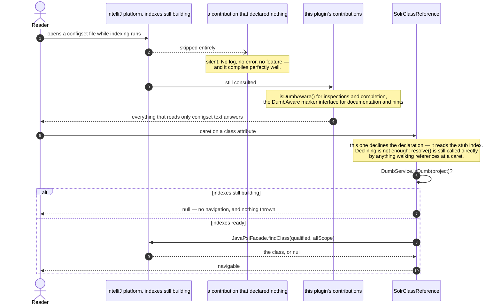
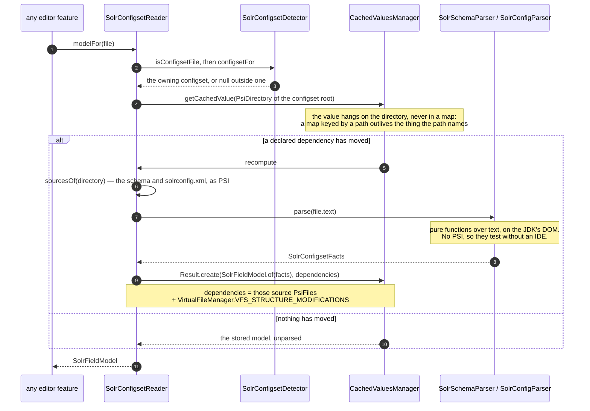
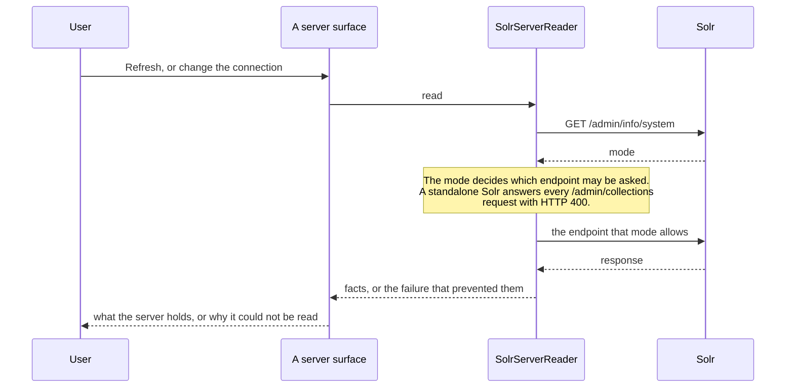
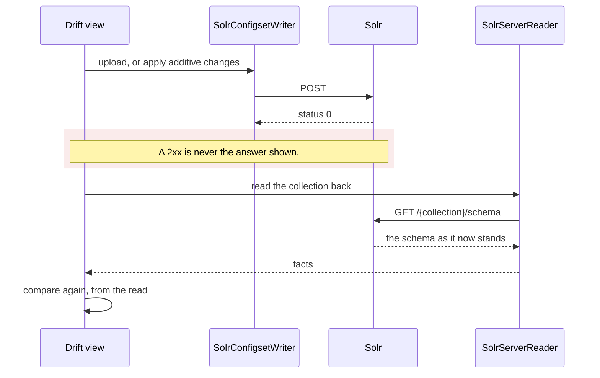

# Platform mechanisms this plugin relies on

Two IntelliJ Platform mechanisms shape code all over this plugin, and neither is guessable from
reading that code: dumb mode and the field-model cache. This page owns the rules for both. It is not
a substitute for the [SDK documentation](https://plugins.jetbrains.com/docs/intellij/); it records
what this plugin decided and why.

---

## Dumb mode, and `DumbAware`

### What it is

When you open a project, IntelliJ builds **indexes** — a searchable database of every class, symbol
and word in it. Until that finishes, the IDE is in **[dumb mode](glossary.md#dumb-mode)**: you can
read and type, but anything backed by an index cannot answer, because its data source is half-built.

> **In Java terms.** Dumb mode is the index being a database still importing — every query against
> it fails, or is skipped outright, until the import finishes. `DumbAware` is not "this code is
> thread-safe" or any other cross-cutting marker you may know from Java; it is a narrow promise about
> one thing only — *I read no index* — and the two ways to make that promise differ by extension
> point (an overridden method here, a marker interface there) with no compiler check that you picked
> the right one for the base class you extended.

The platform's rule is deliberately conservative:

> A contribution that has not declared itself dumb-aware is **skipped entirely** while the project
> is indexing.

Answering from a partial index produces confidently wrong results — a
[Find Usages](glossary.md#find-usages) that reports three usages when there are nine is worse than
one that declines. So the default is silence, and a feature that does not need an index has to say
so.

### Why it matters here

**Almost nothing in this plugin reads an index.** The field model is parsed from the text of the
configset's files, and the activation gate reads library names off the project model rather than
[PSI](glossary.md#psi). An undeclared contribution therefore loses nothing by running during
indexing — but if it does not declare itself, it does nothing at all while a project indexes, with
nothing logged. That is absence during the exact window when someone opening a Solr project for the
first time is most likely to be opening configset files.

The one exception is class navigation: resolving the class a `class` attribute names goes through
`JavaPsiFacade`, which reads the stub index.

### The rules

**Every contribution that reads no index declares itself dumb-aware.** No answer this plugin gives
from configset text gets more correct by waiting for the index.

**A contribution that does read an index must both decline the declaration *and* guard with
`DumbService`.** Declining keeps it out of the paths that consult the flag, but its `resolve` is
still called directly by anything walking references at a caret. Unguarded, that throws during
indexing and takes the whole quick-documentation popup with it, including the parts that needed no
index. Both, never either.

**Declaring dumb-awareness is a promise about data sources.** Adding an index read to a feature that
declares it — a Find Usages provider backed by a stub index, a recognizer resolving Java symbols —
is a silent correctness bug unless the declaration is dropped or the read is guarded.

How a contribution opts in is not uniform, and the marker-interface cases are the dangerous ones:
adding `DumbAware` to a class the platform does not check for it **compiles cleanly and does
nothing**.

| Contribution | How it opts in |
|---|---|
| `LocalInspectionTool` ([inspection](glossary.md#inspection)) | `override fun isDumbAware()` |
| [`CompletionContributor`](glossary.md#completion-contributor) | `override fun isDumbAware()` |
| [`DocumentationProvider`](glossary.md#documentation-provider) | `DumbAware` marker interface |
| Declarative [inlay](glossary.md#inlay-hint) provider | `DumbAware` marker interface |
| `ToolWindowFactory` | `DumbAware` marker interface |
| `PsiReferenceContributor` | **neither** — [reference](glossary.md#reference) contributors are not filtered this way |

### What holds it

`SolrDumbModeContractTest` runs one case per opt-in mechanism inside
`DumbModeTestUtils.runInDumbModeSynchronously` — documentation on a `class` value, completion, an
inspection, the query console — and asserts each surface still answers. A dumb-mode test is only
worth having if it fails with the declaration removed; every other fixture in the suite runs in smart
mode and would stay green either way.

---

## Caching the field model

### The problem

Every editor feature asks the same question — *what fields does this configset declare?* — many
times per keystroke, and answering means parsing the configset's XML. So the model is cached, and
the whole difficulty is **knowing when to throw it away**:

- Rebuild too rarely and every feature is confidently wrong at once about a field the user just
  deleted.
- Rebuild too often and the configset is reparsed on every keystroke *anywhere in the project* —
  not incorrect, just an editor that stutters for reasons nobody can see.

### What we do

[`CachedValuesManager`](glossary.md#cachedvaluesmanager) — the platform's mechanism. You supply a
computation and a list of **dependencies**; the platform owns storage, thread-safety, eviction under
memory pressure, and recomputation when any dependency's modification count moves.

> **In Java terms.** Reaching for a `ConcurrentHashMap` and a manual `invalidate()` call is the
> ordinary Java instinct here, and it is the wrong one. `CachedValuesManager` inverts the
> relationship: you never call invalidate at all — you declare the *dependencies* whose modification
> count the platform watches, and it evicts on your behalf when one moves. Closer to a memoizing
> `Supplier` keyed off a `ModificationTracker` than to a hand-rolled LRU.

### The rules

**Never build a cache in front of `SolrConfigsetReader.modelFor`.** It already caches. A fact read
from a file the reader does not already read must join `sourcesOf`, the dependency list, or the
model goes stale after the first edit — silently.

**The cache hangs on the `PsiDirectory` of the configset root, not in a map.** A map keyed by a path
outlives the thing the path names: a configset deleted and recreated at the same path would find an
entry built against files that no longer exist, surfacing as `InvalidVirtualFileAccessException`
from inside the cache. Attached to the directory, the cache's lifetime is exactly the directory's.
It also keeps tests honest: [`BasePlatformTestCase`](glossary.md#baseplatformtestcase) reuses one
light project across test classes, so anything a project-level service holds in a field leaks into
the next test.

**The dependency list is the source files plus the VFS structure count.** Neither half can be
dropped:

| Dependency | Catches | Why the obvious alternative is wrong |
|---|---|---|
| The source `PsiFile`s | Edits to *this* schema or `solrconfig.xml` | `PsiModificationTracker.MODIFICATION_COUNT` is the reflex, and it advances on **any** PSI change in the project — a keystroke in unrelated Java would reparse the configset. |
| `VirtualFileManager.VFS_STRUCTURE_MODIFICATIONS` | A `solrconfig.xml` appearing in a configset that had none | Nothing file-scoped can catch this: a file that did not exist when the model was built cannot be on its list. `testASolrconfigAddedLaterIsPickedUp` holds it. |

The cost of the VFS dependency is that creating or deleting *any* file in the project invalidates
the model. Structural changes are rare next to keystrokes, and the recomputation is two small XML
files.

**The model is derived from PSI, not from the `Document`.** Unsaved edits still count, because PSI
reflects the editor's buffer long before anything reaches disk, and the model cannot run ahead of
the PSI its consumers are visiting. In tests, an edit must be committed
(`PsiDocumentManager.commitAllDocuments`) before the model reflects it; the IDE commits before
running any feature that reads the model.

### What deliberately stays hand-written

`SolrConfigsetLocator` keeps its own cache. It memoizes *which configset owns a file*, and every
input to that answer is a name or a directory listing — so its correct dependencies are the VFS
**structure** count and the settings modification count, and content edits must be ignored. It
already tracks exactly those two. Converting it would replace one correct tracker-based cache with
another; do not "finish the job".

---

## Talking to a server without blocking the editor

Two mechanisms carry every server call, and both keep a promise the editor surfaces depend on:
**nothing on the editor path contacts a server**, and nothing a user is looking at waits on one.

### The call is suspending, and interruptible

`SolrHttpTransport` is a suspending function over `java.net.http.HttpClient`, and it wraps the
blocking send in `runInterruptible` rather than plain `withContext(Dispatchers.IO)`. Coroutine
cancellation is cooperative, so a `withContext` block sitting inside a blocking JDK call does not
stop when its job is cancelled; `runInterruptible` interrupts the thread, and the JDK call throws.
The test that pins this asserts elapsed time, not just that the job reported itself cancelled.

### Every read is on request, and every write re-reads

**There is no timer anywhere.** Server state refreshes on request and on connection change, and on
nothing else. A cache in front of a fetch is fine and is invalidated by exactly those two events.

After a write the same read runs again, and the view reports *that* rather than the write's own
answer. A configset upload lacking `_version_` returns `responseHeader.status` 0, appears in
`action=LIST`, and Solr then refuses to build a collection from it. "The request was accepted" and
"the server now agrees" are different facts, and only the second is worth showing a user.

